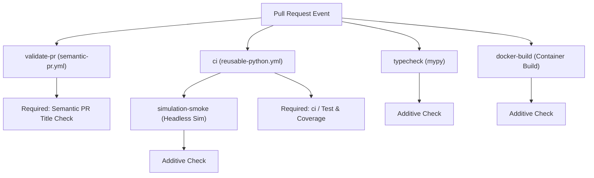

# Additive CI Runners Pattern

This guide describes the **Additive CI Runners Pattern** in `repokit`. It explains how repositories can introduce project-specific CI jobs—such as static type checking, container image builds, performance benchmarks, and hardware-in-the-loop simulations—while remaining strictly compliant with centralized `repokit` governance and branch protection rulesets.

---

## 1. The Architectural Challenge: Central Governance vs. Customization

Modern engineering stacks require both **centralized consistency** (standardized Conventional Commit checks, linting baselines, code coverage gates) and **domain-specific flexibility** (unique build tools, container packaging, simulation harnesses, matrix deployments).

### The Anti-Pattern: Forking or Bypassing Governance
When repositories diverge by writing completely bespoke `.github/workflows/ci.yml` files from scratch:
- Central updates (e.g. upgraded linter configurations, security scanners, or dependency vulnerability patches) must be manually backported across dozens of repositories.
- GitHub branch protection rulesets break because required status check names no longer match.
- `repokit audit` flags the repository as non-compliant.

### The Solution: Additive CI Runners
The Additive CI Runners pattern preserves the canonical contract required by `repokit` governance while allowing individual repositories to run arbitrary custom jobs alongside standard governance workflows.

---

## 2. GitHub Ruleset Check Context Matching

To understand why CI workflows must be structured intentionally, consider how GitHub Actions derives status check contexts for reusable workflows:

When a caller workflow declares a job invoking a reusable workflow:
```yaml
jobs:
  validate-pr:
    if: github.event_name == 'pull_request'
    uses: Cooper-Wallace/repokit/.github/workflows/semantic-pr.yml@main

  ci:
    uses: Cooper-Wallace/repokit/.github/workflows/reusable-python.yml@main
```

GitHub Actions combines the **caller job ID** and the **reusable workflow job name** into a slash-separated status check context:
- For `validate-pr`: The workflow displays as `Semantic PR Title Check / Validate Conventional Commit PR Title`.
- For `ci`: The caller job is `ci`, and the inner job in `reusable-python.yml` is `name: "Test & Coverage"`. GitHub Actions reports this check as:
  ```text
  ci / Test & Coverage
  ```

### The Ruleset Requirement
The repository's branch protection ruleset explicitly requires:
1. `Semantic PR Title Check / Validate Conventional Commit PR Title`
2. `ci / Test & Coverage`

> [!IMPORTANT]
> The caller job ID invoking your language's reusable workflow **must be named `ci`**. If you rename the caller job to `test`, `python-ci`, or `backend`, GitHub Actions will publish the check as `test / Test & Coverage`, which **will not match** the required check context in the ruleset, indefinitely blocking the PR merge button!

---

## 3. Pattern A: In-File Additive Jobs in `ci.yml`

In **Pattern A**, additional validation jobs are added directly to `.github/workflows/ci.yml`. These jobs run concurrently with the standard `validate-pr` and `ci` jobs.

### Use Case
Use Pattern A when your repository requires additional pre-merge validation checks (e.g. strict type checking, container build validation, integration smoke tests) that should execute on every pull request.

### Complete Example: Python Repo with Mypy, Docker & Simulation

```yaml
name: CI

on:
  pull_request:
    branches: [main]
  push:
    branches: [main]

permissions:
  contents: read
  pull-requests: read

jobs:
  # -------------------------------------------------------------
  # Standard repokit Governance Jobs (MANDATORY)
  # -------------------------------------------------------------
  validate-pr:
    if: github.event_name == 'pull_request'
    uses: Cooper-Wallace/repokit/.github/workflows/semantic-pr.yml@main

  ci:
    uses: Cooper-Wallace/repokit/.github/workflows/reusable-python.yml@main
    with:
      python-version: "3.11"
      min-coverage: 85

  # -------------------------------------------------------------
  # Additive Runner 1: Strict Static Type Checking (mypy)
  # -------------------------------------------------------------
  typecheck:
    name: "Static Type Checking"
    runs-on: ubuntu-latest
    steps:
      - name: Checkout code
        uses: actions/checkout@v4

      - name: Set up Python
        uses: actions/setup-python@v5
        with:
          python-version: "3.11"

      - name: Install dependencies
        run: |
          python -m pip install --upgrade pip
          pip install mypy
          if [ -f requirements.txt ]; then pip install -r requirements.txt; fi

      - name: Run mypy
        run: |
          mypy src/ --strict

  # -------------------------------------------------------------
  # Additive Runner 2: Docker Container Build Smoke Test
  # -------------------------------------------------------------
  docker-build:
    name: "Container Build Validation"
    runs-on: ubuntu-latest
    steps:
      - name: Checkout code
        uses: actions/checkout@v4

      - name: Set up Docker Buildx
        uses: docker/setup-buildx-action@v3

      - name: Build test image
        uses: docker/build-push-action@v5
        with:
          context: .
          push: false
          tags: app/smoke-test:latest

  # -------------------------------------------------------------
  # Additive Runner 3: Domain Simulation Smoke Test
  # -------------------------------------------------------------
  simulation-smoke:
    name: "Simulation Smoke Test"
    runs-on: ubuntu-latest
    needs: [ci]  # Optional: only execute after core unit tests pass
    steps:
      - name: Checkout code
        uses: actions/checkout@v4

      - name: Run domain simulation
        run: |
          bash scripts/run_headless_sim.sh --duration 30
```

### Execution Flow


---

## 4. Pattern B: Sidecar Workflow Files

In **Pattern B**, customized pipelines reside in dedicated workflow files inside `.github/workflows/` (e.g. `benchmarks.yml`, `deploy.yml`, `nightly.yml`), running alongside the canonical `ci.yml`.

### Use Case
Use Pattern B when:
1. The custom jobs have distinct event triggers (e.g., `schedule: cron`, `workflow_dispatch`, or releases).
2. The custom jobs require heavy resources or specialized self-hosted runners that should not burden every PR push.
3. The custom jobs belong to separate lifecycle concerns (e.g., continuous deployment or performance regression benchmarking).

### Example 1: Microbenchmark Regression Sidecar (`.github/workflows/benchmarks.yml`)

```yaml
name: Performance Benchmarks

on:
  pull_request:
    paths:
      - "src/core/**"
      - "benchmarks/**"
  workflow_dispatch:

jobs:
  benchmarks:
    name: "Criterion Microbenchmarks"
    runs-on: ubuntu-latest
    steps:
      - name: Checkout code
        uses: actions/checkout@v4

      - name: Run benchmarks
        run: |
          pytest benchmarks/ --benchmark-only --benchmark-json=output.json
```

### Example 2: Container Deployment Sidecar (`.github/workflows/deploy.yml`)

```yaml
name: CD Pipeline

on:
  push:
    branches: [main]

jobs:
  deploy:
    name: "Deploy Production Artifacts"
    runs-on: ubuntu-latest
    steps:
      - name: Checkout code
        uses: actions/checkout@v4

      - name: Publish Artifacts
        run: |
          echo "Deploying to production environment..."
```

---

## 5. Compliance & `repokit audit` Verification

The `repokit audit` command validates whether a repository complies with local and remote standards.

### How `repokit audit` Evaluates CI Compliance
When running `repokit audit` (or `repokit audit --local`), the audit engine checks `.github/workflows/ci.yml`:

```python
ci_workflow_path = repo_root / ".github" / "workflows" / "ci.yml"
has_ci_workflow = False
if ci_workflow_path.exists():
    try:
        ci_content = ci_workflow_path.read_text(encoding="utf-8")
        if (
            DEFAULT_GOVERNANCE_REPO in ci_content
            or "reusable-" in ci_content
            or "Cooper-Wallace/repokit" in ci_content
        ):
            has_ci_workflow = True
    except Exception:
        pass
```

### Why Additive Workflows Pass Compliance
Because `repokit audit` verifies that:
1. `.github/workflows/ci.yml` exists.
2. The file references the central governance reusable workflows (`reusable-` or `Cooper-Wallace/repokit`).

Any number of additive jobs can be included in `ci.yml` (Pattern A), and any number of sidecar workflows can be introduced (Pattern B). As long as the canonical `ci` and `validate-pr` jobs remain present, `repokit audit` passes cleanly with:
```text
✔ CI Workflow calling central repokit workflows (.github/workflows/ci.yml)
```

---

## 6. Best Practices & Checklist

When extending a repository with custom CI runners:

- [ ] **Preserve Job ID `ci`**: Always call the language reusable workflow with job ID `ci` so GitHub Actions emits the status check context `ci / Test & Coverage`.
- [ ] **Preserve Job ID `validate-pr`**: Always include the Semantic PR Title validation job.
- [ ] **Isolate Heavy Dependencies**: For tools not included in the standard language runners (e.g. `mypy`, Docker Buildx, Playwright), install them inside the additive job rather than attempting to inject them into the reusable workflow.
- [ ] **Use `needs` for Sequential Gating**: If an additive job is expensive (e.g. long simulations or cloud deployments), add `needs: [ci]` so it runs only if unit tests and coverage thresholds pass.
- [ ] **Verify with `repokit audit`**: Run `repokit audit --local` after modifying workflows to verify local compliance before opening your PR.
